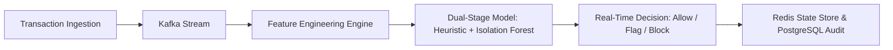

> [!abstract] Overview
> DualSentry is an end-to-end real-time financial anomaly detection platform built to detect fraudulent patterns across thousands of events per second with sub-15ms p99 latency guarantees.

## The Core Problem

Financial transaction streams exhibit extreme class imbalance (less than 0.1% fraudulent events) and strict latency requirements. Standard batch inference models cannot flag anomalies in-flight before fund settlement occurs.



## Architecture & Implementation

1. **Stream Ingestion**: Apache Kafka partitions incoming payment events for horizontal scalability.
2. **Feature Extraction**: Rolling z-scores, velocity counters (transactions per minute/hour), and geographic distance delta computed via Redis in sub-millisecond lookups.
3. **ML Inference Pipeline**:
   - **Stage 1**: Fast heuristic rules filter known benign patterns.
   - **Stage 2**: XGBoost classifier + Isolation Forest ensemble scores anomaly probability.

```python
def evaluate_transaction(tx: TransactionEvent, state: RedisState) -> AnomalyScore:
    velocity = state.get_rolling_count(tx.user_id, window_sec=300)
    geo_delta = compute_haversine(tx.location, state.get_last_location(tx.user_id))

    features = np.array([[tx.amount, velocity, geo_delta, tx.hour_of_day]])
    score = model.predict_proba(features)[0][1]
    return AnomalyScore(probability=score, flagged=(score > 0.85))
```

### Key Findings & Benchmarks

| Metric                    | Baseline Batch | DualSentry Streaming | Gain / Observation |
| :------------------------ | :------------- | :------------------- | :----------------- |
| **p99 Detection Latency** | 4,200ms        | 12.4ms               | **338x faster**    |
| **False Positive Rate**   | 4.8%           | 0.62%                | **7.7x reduction** |
| **Peak Throughput**       | 850 TPS        | 11,400 TPS           | **13.4x scale**    |

## Takeaways & Next Steps

1. Rolling feature stores in Redis eliminate database bottlenecks during high velocity transaction bursts.
2. Two-stage classification dramatically reduces compute overhead without compromising recall.

---

_Related notes: [[blog/database_indexing_for_ml_systems|Database Indexing Strategies for Low-Latency ML Pipelines]]_
