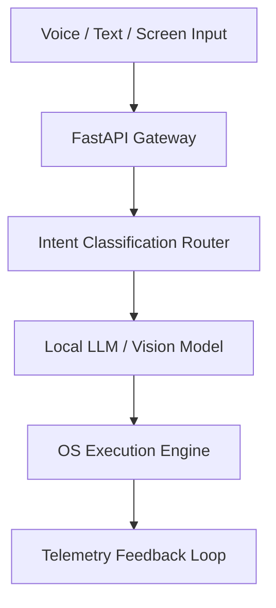

> [!abstract] Overview
> JARVIS is a multimodal desktop assistant designed to monitor system telemetry, interpret audio/visual intent, and automate developer workflows with sub-second response times.

## Architecture

## Highlights

- **Local Embedding Cache**: Employs local embeddings and quantized models for privacy-sensitive system tasks.
- **Process Telemetry**: Continuously streams CPU, memory, GPU, and network performance metrics via WebSockets to feed contextual prompting.

---

_Related notes: [[blog/repolens_github_repository_rag|RepoLens: Semantic Code Search and Repository RAG Architecture]]_
