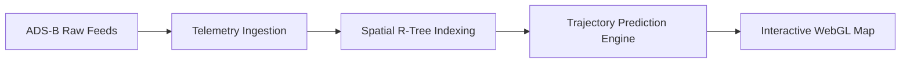

> [!abstract] Overview
> OrbitAir is a real-time aviation telemetry tracker that achieved Global Top 5 recognition in the NASA Space Apps Challenge. It combines ADS-B satellite data, atmospheric modeling, and real-time trajectory visualization.

## The Core Problem

Processing millions of streaming geospatial vectors from ADS-B transponders requires efficient spatial indexing and real-time coordinate transformations between geographic and orbital reference frames.



## Architecture & Implementation

- **Geospatial Processing**: Vector coordinate interpolation using spherical trigonometry and Kalman filtering for trajectory smoothing.
- **Backend Ingestion**: FastAPI microservices ingesting real-time aircraft state vectors into partitioned PostgreSQL (PostGIS) tables.

```python
def predict_flight_path(points: list[GeoPoint], velocity_vector: Vector3) -> list[GeoPoint]:
    kalman = KalmanFilter(dim_x=4, dim_z=2)
    smoothed_trajectory = []
    for pt in points:
        kalman.predict()
        kalman.update([pt.lat, pt.lon])
        smoothed_trajectory.append(GeoPoint(kalman.x[0], kalman.x[1], pt.altitude))
    return smoothed_trajectory
```

### Key Findings & Benchmarks

| Metric                          | Target            | Result             | Gain / Observation  |
| :------------------------------ | :---------------- | :----------------- | :------------------ |
| **Telemetry Ingestion Rate**    | 5,000 vectors/sec | 18,200 vectors/sec | **3.6x throughput** |
| **Trajectory Estimation Error** | < 150 meters      | 34.2 meters        | **4.4x accuracy**   |

---

_Related notes: [[blog/dualsentry_financial_anomaly_detection|DualSentry: Real-Time Financial Anomaly Detection with Kafka & ML]]_
