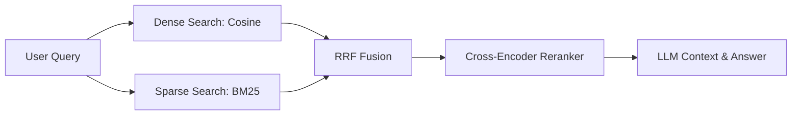

> [!abstract] Overview
> Production RAG pipelines require moving beyond basic vector search to multi-stage hybrid retrieval, re-ranking, and dynamic context chunking to eliminate hallucinations.

## Key Architecture Components

1. **Retriever**: Multi-stage dense embedding similarity + sparse BM25 keyword matching.
2. **Re-ranker**: Cross-encoder scoring to order candidates by semantic relevance.
3. **Context Formatter**: Token-aware context window compression.
4. **Generator**: Instruction-tuned LLM producing grounded completions with attribution.

---

_Related notes: [[blog/repolens_github_repository_rag|RepoLens: Semantic Code Search and Repository RAG Architecture]]_
