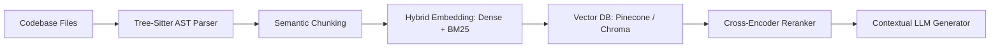

> [!abstract] Overview
> RepoLens enables natural language code exploration and semantic question-answering over large multi-language codebases using recursive AST chunking and hybrid embeddings.

## The Core Problem

Standard token chunking breaks code semantics across function boundaries, syntax structures, and import declarations. Naive text RAG fails when queried on programmatic logic or architectural questions.



## Implementation Highlights

- **AST-Aware Chunking**: Uses Tree-sitter parsers to slice code into discrete classes, methods, and interface signatures.
- **Hybrid Retrieval**: Dense embeddings (e.g. `text-embedding-3-small`) combined with BM25 sparse keyword indices and reciprocal rank fusion (RRF).

```python
def retrieve_code_context(query: str, vector_store: VectorStore, top_k: int = 5) -> list[CodeChunk]:
    dense_results = vector_store.similarity_search(query, k=top_k * 2)
    sparse_results = vector_store.bm25_search(query, k=top_k * 2)

    # Reciprocal Rank Fusion (RRF)
    fused_scores = rrf_fusion([dense_results, sparse_results], k=60)
    return rerank_with_cross_encoder(query, fused_scores)[:top_k]
```

### Key Findings & Benchmarks

| Metric                      | Naive Chunking | AST + Hybrid RAG | Gain / Observation |
| :-------------------------- | :------------- | :--------------- | :----------------- |
| **Code Retrieval Recall@5** | 44.2%          | 89.6%            | **2.02x recall**   |
| **Hallucination Rate**      | 22.8%          | 3.1%             | **7.3x reduction** |

---

_Related notes: [[blog/rag_systems_hybrid_retrieval_guide|Retrieval-Augmented Generation (RAG): Hybrid Retrieval & Embeddings Guide]]_
